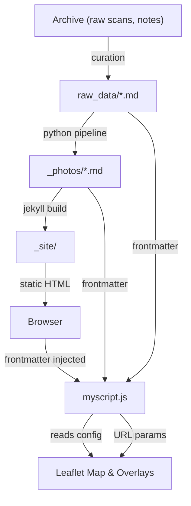
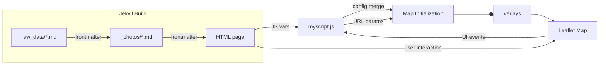
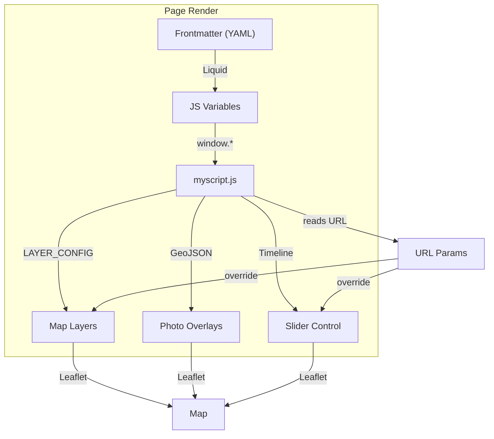
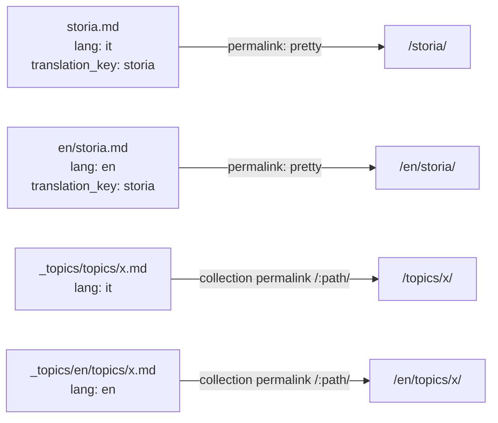

## Overview



Historical material is first collected from archival scans, social-history contributions, and manual research notes, then normalized by an editor into one Markdown file per photo object inside `raw_data/`.
Each `raw_data` entry represents a single historical record: descriptive text + structured metadata (date, labels, location geometry, and one primary image with optional variants).
Original research material is stored in `archive/`, then curated to production level in `raw_data/` as input to the python pipeline to produce jekyll collection items in `_photos/`.

This site is a static Jekyll project with a Python preprocessing pipeline and a client-side JavaScript data layer for interactive maps and overlays.

**General Data Flow:**
1. Historical and research material is curated into Markdown files in `raw_data/`, each with YAML frontmatter for metadata (title, date, labels, location, images).
2. The Python pipeline (`scripts/process_research.py`) processes these into normalized, runtime-ready Markdown in `_photos/`, generating image assets and GeoJSON overlays.
3. Jekyll builds the static site, rendering pages from `_photos/` and `_topics/` collections.
4. Client-side JavaScript (notably `assets/js/myscript.js`) powers interactive maps, overlays, and UI features, reading configuration from page frontmatter and URL parameters.

**Key Principles:**
- All source data is edited in `raw_data/` (never `_photos/`).
- All external JS/CSS dependencies are loaded via pinned CDN URLs (see `_config.yml`).
- No backend: all state is in URLs, frontmatter, or localStorage.
- Defensive coding: errors are logged, never silent.

---

## JavaScript Data Flow and Frontmatter Integration

### Overview

The main interactive logic is handled by `assets/js/myscript.js`, which powers the Leaflet-based maps and overlays on photo, topic, and map pages. This script is designed to:

- Dynamically load map layers (tiles, rasters, images, GeoJSON) based on both page frontmatter and URL parameters.
- Read configuration variables injected by Jekyll layouts (from page frontmatter) and merge them with runtime URL parameters for per-page and per-session customization.
- Support topic-specific overlays and filtering, timeline sliders for historical maps, and custom controls (reset zoom, opacity, fullscreen, geolocation).
- Ensure accessibility and robust error handling (all resource loads are checked, errors are logged, and missing/malformed data falls back to safe defaults).


### How Frontmatter Drives JavaScript Behavior



Jekyll layouts inject frontmatter variables as global JS variables (e.g., `centerLat`, `centerLng`, `zoomLevel`, `activeLayers`, `topicSlug`, `topicFeaturedPhotos`, `photoOriginGeoJson`, etc.). These are read by `myscript.js` at runtime to configure the map:

- **Map Center/Zoom:**
    - `centerLat`, `centerLng`, `zoomLevel` (from frontmatter, can be overridden by `?center=` and `?zoom=` URL params)
- **Active Layers:**
    - `activeLayers` (array from frontmatter, or `?layers=` URL param)
- **Topic Context:**
    - `topicSlug`, `topicFeaturedPhotos` (from topic page frontmatter)
    - If present, loads overlays from topic-specific GeoJSON or filters global photo layers to only show featured photos
- **Photo Detail Context:**
    - `photoOriginGeoJson`, `photoFovGeoJson`, `photoLineGeoJson` (from photo page frontmatter)
    - If present, adds overlays for the specific photo’s origin, field of view, and line of sight

All these variables are set in the page’s HTML by the Jekyll layout, using Liquid templating to output the frontmatter values as JS assignments before loading `myscript.js`.


### Data Flow in `myscript.js`



1. **Configuration Merge:** Reads global JS variables (from frontmatter) and merges with URL params for runtime config.
2. **Layer Setup:** Builds a `LAYER_CONFIG` object for all map layers (basemaps, overlays, rasters, images, GeoJSON), using asset paths resolved from the Jekyll base URL.
3. **Map Initialization:**
     - Creates the Leaflet map with the configured center/zoom.
     - Adds base and overlay layers as specified by config.
     - Loads GeoJSON overlays for photos, FOVs, and lines, filtering by topic or photo as needed.
     - Adds timeline slider if multiple historical rasters are present.
     - Adds custom controls (reset, opacity, fullscreen, geolocation, context menu).
4. **Frontmatter-Driven Overlays:**
     - On photo pages, overlays are built from the `location.*_geojson` fields injected by the pipeline and passed via frontmatter.
     - On topic pages, overlays are filtered or loaded based on `featured_photos` and topic-specific GeoJSON.
5. **Error Handling:** All resource loads are checked; missing or malformed data falls back to defaults and logs to the console.

### Example: Passing Frontmatter to JS

In a Jekyll layout (e.g., `_layouts/photo.html`):

```liquid
<script>
    var centerLat = {{ page.centerLat | default: 41.3551 }};
    var centerLng = {{ page.centerLng | default: 14.3722 }};
    var zoomLevel = {{ page.zoomLevel | default: 17 }};
    var activeLayers = {{ page.activeLayers | jsonify }};
    var photoOriginGeoJson = {{ page.location.origin_geojson | jsonify }};
    // ...etc
</script>
<script src="{{ site.baseurl }}/assets/js/myscript.js"></script>
```

### Developer Notes

- Never hardcode asset or API URLs in JS; always resolve from frontmatter or `_config.yml`.
- All JS dependencies must be loaded from pinned CDN URLs with SRI hashes.
- If a map or overlay fails to load, check the browser console for errors and verify the frontmatter variables are present and correctly formatted.
- When adding new overlays or features, update both the JS config and the frontmatter schema as needed.

---

Markdown files frontmatter contains information to build the site ad the embedded leaflet maps :

- frontmatter in `raw_data/*md` : human-curated metadata such as title, date, labels, location coordinates, map settings, original_url, and image references (images[] preferred, or legacy primary_image + variants).
- frontmatter in `_photos/*md` (processed/generated): keeps source fields and adds runtime fields generated by the Python pipeline: normalized image objects with final asset paths + thumbnails, processed_primary_image, processed_primary_thumb, processed_images, normalized variants, and map-ready location.*_geojson fields (when geometry is available


The core pattern is:

1. Curate source entries in `raw_data/`
2. Run the Python pipeline (`scripts/process_research.py`)
3. Build the site with Jekyll
4. Serve generated output from `_site/`

The architecture is intentionally one-way: source data is edited in `raw_data/`, while `_photos/` and generated assets are pipeline outputs.

---

## Data Flow (Archive → Raw Data → _photos)

### 1) `archive/` (private historical backup)
- Long-term backup for source material and intermediate notes.
- Not intended for Jekyll rendering.
- Excluded from build in `_config.yml`.

### 2) `raw_data/` (authoritative editable source)
- Each Markdown file represents one historical photo object.
- Uses YAML frontmatter + narrative body content.
- This is the **single editable source of truth** for photo metadata.

Current supported image schemas:

- Preferred schema:

```yaml
images:
    - file: "source-image.jpg"
        is_primary: true
        type: "original"
        note: "Main shot"
        alt: "Accessible alt text"
```

- Legacy fallback schema (still supported by pipeline):

```yaml
primary_image: "source-image.jpg"
variants:
    - file: "variant-image.jpg"
        type: "restoration"
        note: "Edited version"
```

### 3) `_photos/` (generated Jekyll collection)
- Auto-generated by Python from `raw_data/*.md`.
- Contains normalized frontmatter used by Jekyll layouts.
- Must not be hand-edited because files are regenerated.

Generated media outputs:

- Primary image: `assets/images/[slug]-main.jpg`
- Primary thumbnail: `assets/thumbs/[slug].jpg`
- Variant images: `assets/images/variants/[slug]/...`
- Variant thumbnails: `assets/thumbs/variants/[slug]/...`

Generated geospatial outputs:

- `assets/maps_data/photos_origin.geojson`
- `assets/maps_data/photos_fov.geojson`
- `assets/maps_data/photos_lov.geojson`

---

## Python Pipeline (`scripts/process_research.py`)

The script is an ETL pipeline for markdown metadata + image assets.

### Processing stages

1. Scan `raw_data/*.md`
2. Parse frontmatter (`python-frontmatter`)
3. Validate required keys (`title`, `date`, `location`, `labels` + image schema)
4. Normalize image metadata to a unified `images[]` structure
5. Optimize images and generate thumbnails (`Pillow`)
6. Add location-derived GeoJSON to frontmatter
7. Write generated `_photos/[slug].md`
8. Aggregate all geometries into GeoJSON files (`geopandas` + `shapely`)

### Frontmatter transformations

The script enriches metadata with runtime-ready fields, including:

- `processed_primary_image`
- `processed_primary_thumb`
- `processed_images`
- `variants` (normalized generated variant metadata)
- `location.origin_geojson`, `location.fov_geojson`, `location.line_of_sight_geojson`

### Error and validation behavior

- Missing required fields or missing image files are logged as errors.
- Invalid entries are skipped rather than silently accepted.
- Successful entries continue processing, enabling partial pipeline success.

### Execution

```bash
python scripts/process_research.py --log INFO
```

Useful dependencies (from `requirements.txt`):
- `python-frontmatter`, `Pillow`, `PyYAML`
- `geopandas`, `shapely`, `pandas`

---

## Jekyll Collections and Rendering

### `photos` collection
- Declared in `_config.yml` with permalink `/photos/:slug/`.
- Source files live in `_photos/` (generated by Python).
- Individual photo pages use `_layouts/photo.html`.

Photo layout behavior:
- Resolves primary image from `processed_images` (with fallbacks).
- Shows variant gallery when multiple images exist.
- Injects location GeoJSON into JavaScript globals for map overlays.
- Loads map scripts/styles only when coordinate data is available.

### `topics` collection
- Declared in `_config.yml` with permalink `/:path/` (ADR-010): the folder under `_topics/` is part of the URL.
- Source files live in a language folder inside `_topics/` (`_topics/topics/` for Italian, `_topics/en/topics/` for English) and are editorial/manual.
- Topic pages use `_layouts/topic.html`.

Topic-photo join model:
- Topic frontmatter includes `featured_photos` entries with `id` values.
- Layout resolves each `id` against `site.photos` by slug.
- This creates explicit many-to-many editorial linking without duplicating photo data.

Example `featured_photos` pattern:

```yaml
featured_photos:
    - id: via-carmine-cotonificio
        commentary: "Historical relation to the square."
```

---

## Internationalization (i18n / l10n)

Implemented per ADR-010. The build stays a plain Jekyll 3 build on GitHub Pages: no i18n plugin (the Pages dependency whitelist does not carry one), no per-language build matrix, no runtime language detection or cookie. Two conventions carry all the meaning.

### The two rules

1. **The folder is the language.** The first path segment of a page, relative to the site root or to its collection root, is the language code.
2. **`translation_key` is the identity.** Two files are translations of each other when they share a `translation_key` — never because they share a filename or a URL suffix.



| Source file | URL | Note |
|---|---|---|
| `index.md` | `/` | the default-language home page |
| `en/index.md` | `/en/` | `index` collapses into its folder: the English home is `/en/`, never `/en/index/` |
| `storia.md` | `/storia/` | root pages keep their historical URL |
| `en/storia.md` | `/en/storia/` | |
| `de/storia.md` | `/de/storia/` | |
| `_topics/topics/x.md` | `/topics/x/` | collection items must live in a folder |
| `_topics/en/topics/x.md` | `/en/topics/x/` | |

A translated home page is therefore just `en/index.md`: no permalink, no config change. The switcher picks up the sibling, and the sidebar Home link resolves to `/en/` while browsing English and to `/` otherwise.

`it` is the default language: it stays at the unprefixed URL, so every published link keeps working. `_config.yml` holds this choice once as `default_lang`, and `scripts/process_research.py` mirrors it as `DEFAULT_LANG`.

### Why folders instead of `:lang` permalinks

Jekyll 3.9 expands only `:collection`, `:path`, `:name`, `:slug`, `:title`, `:output_ext` and the date tokens in a permalink template. `:lang` is not a placeholder: a template mentioning it aborts the build with *"The URL template doesn't have lang keys"*.

The `topics` collection therefore uses `permalink: /:path/`. Two properties of `:path` shape the convention:

- `:path` is the subdirectory **plus the filename**, so `/:path/` reproduces the old `/topics/<slug>/` for files in `_topics/topics/` and produces `/en/topics/<slug>/` for files in `_topics/en/topics/`.
- `:path` is **not slugified**: filenames must already be URL-safe (lowercase, dashes, no accents, no spaces).

The alternative, a per-file `permalink:` in every translated file, also works but fails silently: forget it once and the page publishes at the wrong URL. Forgetting a language folder is structurally impossible, because the URL is derived from where the file lives.

### Front matter contract

| Key | Required | Meaning |
|---|---|---|
| `lang` | on every content page | one of `it`, `en`, `de` (`SUPPORTED_LANGS` in `scripts/process_research.py`) |
| `translation_key` | on translatable pages | stable identifier shared by all languages of one page; never reuse it for a different page |

`lang` must agree with the folder: a file outside any language folder is `default_lang`, and `en/…` must declare `lang: en`. A mismatch is reported by `--check`, not discovered in production.

### Monolingual pages

A page with **no `translation_key`** belongs to no translation group, so it may declare any `lang` and sit anywhere. `technical.md` uses this: it is `lang: en` at the root, published at `/technical/` for every reader. Reserve this for pages that are genuinely not translated; anything a reader expects in their language needs a `translation_key` and one folder per language.

Repository documents (`README.md`, `AGENTS.md`, `LICENSE.md`, …) are excluded from the page scan (`NON_PAGE_MARKDOWN` in the pipeline) and need no `lang`.

Two pages take this route for different reasons. `technical.md` is English-only by editorial choice. `404.md` cannot be translated at all: the host serves that one file for every missing URL, whatever language the reader was browsing, so giving it a `translation_key` would leave a permanent phantom gap in the coverage report. It also carries an explicit `permalink: 404.html` — the one legitimate exception to the no-permalink rule, since the host, not the folder, dictates that name.

### Adding a translation

1. Copy the source file into the language folder, keeping the same name: `storia.md` → `en/storia.md`. To create every missing file for one language at once, use `make i18n-scaffold LANG=en`.
2. Set `lang: en`; keep `translation_key` unchanged.
3. Translate the body. Do not duplicate shared data (coordinates, dates, labels) into the front matter: those live in `raw_data/` and are referenced, not copied.
4. For a topic, place it under the collection folder: `_topics/en/topics/<same-filename>.md`.
5. Run `python scripts/process_research.py --check`: it reports missing languages, duplicate languages, folder/`lang` mismatches, and keys with no default-language version.

### UI strings

Interface labels live in `_data/i18n.yml`, one dictionary per language, and templates contain no literals:

```yaml
it:
  label: Italiano
  nav:
    home: Home
    photos: Foto
```

`_includes/sidebar.html` resolves `t = site.data.i18n[page.lang]`, falling back to `site.data.i18n[site.default_lang]`, and renders every label from `t`. Adding a language means adding one dictionary and one folder; no template changes.

Long editorial text does **not** belong here: it belongs in a translated page.

**Site chrome is localized the same way.** `site.title`, `site.tagline` and `site.description` come from `_config.yml` and are Italian, so a language that wants different wording adds a `site:` block to its dictionary:

```yaml
en:
  site:
    title: "The Egg Cotton Mill of Piedimonte Matese"
    tagline: "An Industrial and Social History Through Maps"
    description: "The history of the Egg Cotton Mill of Piedimonte Matese, …"
```

Templates read `t.site.title | default: site.title`, so omitting the block falls back to `_config.yml` instead of rendering empty. That keeps `_config.yml` the default-language source of truth rather than a duplicate of `it:`. The three consumers are the masthead (`_layouts/default.html`), the sidebar description (`_includes/sidebar.html`) and the browser tab (`_includes/head.html`); `atom.xml` deliberately keeps the Italian title, since the feed is a single-language artefact.

The tab title on a home page uses the site title and tagline, selected by `page.translation_key == 'index'` rather than by comparing `page.title` to a literal `"Home"`, so it works in every language.

### Navigation and fallback

- **Language switcher** (`_includes/lang-switcher.html`) groups `site.pages` and `site.topics` by `translation_key` and links to the siblings that exist, listed default-language first and then alphabetically. With no sibling it renders `switcher.unavailable` ("Disponibile solo in italiano") instead of a link. A missing translation is never a 404. The markup is a bare sequence of inline items — spacing, the divider between languages and the emphasis on the current one live in `assets/css/lanyon.css` under `.lang-switcher`, not in the template.
- **Sidebar links** (`_includes/nav-link.html`) resolve each target by `translation_key` plus `page.lang`, and fall back to the default-language page. An English page therefore links to `/en/storia/` where it exists and to `/storia/` where it does not.
- **Listings** (sidebar topic list, `topics.md`) show an item with no `lang` in every language, and an item that declares one only under its own language. Language-neutral data, such as generated photos today, is visible everywhere; once photos carry `lang`, the photo and label indexes need the same filter.

### Checking coverage

`--check` answers *is anything wrong*. `scripts/i18n_report.py` answers *what is not written yet*: it prints the translation graph, one row per `translation_key`, one column per target language.

```text
Target languages: it (default), en, de

PAGES
  translation_key  it  en  de  missing
  about            x   -   -   en, de
  storia           x   -   -   en, de

MONOLINGUAL (no translation_key: one URL, every language)
  404.md  [it]  /404.html
  technical.md  [en]  /technical/

SUMMARY
  keys=8  complete=0/8  missing_edges=16
```

Target languages come from `_data/i18n.yml`, so the report asks for exactly the languages the interface promises, in the order declared there.

- `make i18n-report` adds `--stale`: translations whose last commit predates their Italian source, i.e. translations that have drifted behind.
- `--format md` produces tables for an issue; `--format json` produces the raw graph.
- `make i18n-scaffold LANG=en` writes the missing files with the source front matter and body copied, ready to translate in place. It never overwrites an existing file.
- `--fail-on-missing` makes the report a CI gate (exit 1).

The script imports `iter_page_files()`, `iter_topic_files()` and the folder rules from the pipeline, so the report and `--check` cannot disagree about what a language folder means.

**Scaffolding is a starting point, not a publishable state.** A scaffolded file copies the Italian body under `lang: en`, so publishing it as-is would serve Italian at an `/en/` URL — the exact failure the folder convention exists to prevent. Create the stubs when the translation will follow immediately; `--check` cannot tell a copied body from a translated one, only a human can.

**Staleness reads git history, not file timestamps.** `--stale` compares the last commit touching each translation with the last commit touching its default-language source. A file with no commit yet is skipped — there is nothing to compare — and a fresh clone with rewritten mtimes produces no false positives.

### Scope boundaries

Deliberately not implemented:

- `hreflang` alternates, localized sitemap entries and language-aware search: SEO is out of scope.
- Italian literals still hardcoded in `assets/js` and in the DataTables configuration. Extracting them into `_data/i18n.yml` is a one-time mechanical pass, not yet done.
- Localized photo records: `_photos/` is generated and carries no `lang`.

---

## Labels System

Labels are not a separate Jekyll collection; they are derived from photo metadata.

### Source
- Every photo can declare `labels` in frontmatter.
- Labels are aggregated at render time from `site.photos`.

### UI pages and behavior

- `labels.md` mounts `_layouts/label.html` at `/labels/`.
- The layout builds a labels badge index dynamically.
- Each label links to `/labels/?tag=label-slug`.
- Client-side filtering removes non-matching rows before DataTables initialization.

Related list/table behavior:
- `/photos/` (`_layouts/photos_index.html`) supports `?label=` prefilter.
- `/labels/` supports `?tag=` prefilter.
- Both tables use DataTables with Italian UI strings and year-desc default sort.

---

## Configuration and Runtime Dependencies

### Central configuration
- `_config.yml` defines site metadata, collections, base URL, and excluded folders.
- CDN endpoints are centralized under `cdn_libs` to avoid URL scattering.

### Client-side dependencies
- Bootstrap 5.x
- DataTables 2.x
- jQuery 3.6
- Leaflet + plugins (georaster, locate control, Bing layer)

Most dependencies are loaded from pinned CDN versions. This keeps the project compatible with static hosting and avoids a JS build pipeline.

---

## Build and Deployment Model

### Local developer flow

1. Edit `raw_data/` and/or `_topics/`
2. Run `scripts/process_research.py`
3. Run Jekyll build/serve
4. Verify generated pages and map overlays

### Output boundaries
- `_site/` is generated output only.
- `_photos/` is generated collection output only.
- Manual edits should target `raw_data/`, `_topics/`, layouts/includes, and config.

This separation reduces drift and preserves reproducibility.

### What Jekyll does not see

`_config.yml` `exclude` names every path that is not site content: the data and tooling directories (`raw_data/`, `scripts/`, `tests/`, `archive/`), the repository documents (`README.md`, `AGENTS.md`, `LICENSE.md`) and the build files (`Gemfile`, `pytest.ini`, `requirements.txt`, `docker-*`, `tags`).

Two parts of that list are not obvious:

- **Dot-directories have to be named even though Jekyll skips them.** The reader ignores anything starting with `.`, so `.ai/` and `.agents/` never reached `_site/` — but the `--watch` listener does not apply the same rule, so editing `.ai/01_STRUCTURE.md` triggered a full regeneration. Listing them in `exclude` silences the watcher; content pages still regenerate normally.
- **Excluding a document removes its URL.** `README.md`, `AGENTS.md` and `LICENSE.md` used to be published as `/README.md`, `/AGENTS/` and `/LICENSE.md`, and `tests/` published the Python sources. Those paths now 404; nothing on the site linked to them.

### Sanity checkers

The checkers answer two different questions. `--check`, `make test` and `leansdd-check.py` ask *is anything wrong*: they are silent while the repository is consistent. `i18n_report.py` asks *what is missing*: it is worth reading even when everything passes, because an untranslated page is not an error but unfinished work. Run the first group before committing, the second when deciding what to write next.

| Command | What it verifies | Fails when |
|---|---|---|
| `python scripts/process_research.py --check` | `raw_data/` frontmatter against `raw_data/schema.json`, image and thumbnail presence, GeoJSON validity, orphan generated files, the i18n graph (ADR-010) | errors are reported (non-zero exit); warnings too with `--strict-warnings` |
| `make test` → `python -m pytest` | unit tests plus the output regression snapshot in `tests/test_baseline.py` | current output diverges from `tests/baseline.json` |
| `python tests/baseline.py` | prints the current observable state; `make update-baseline` records it as the new reference | never (it is the recorder) |
| `python scripts/i18n_report.py` | translation coverage per `translation_key`, stale translations | audit errors; missing translations with `--fail-on-missing` |
| `python3 .ai/scripts/leansdd-check.py` | Lean SDD structure of `.ai/` (framework docs, not site data) | structural errors in `.ai/` |

The first four guard repository data; the last guards the process documentation. `scripts/rangeserver.py` is not a checker: it serves files with HTTP Range support for testing Cloud-Optimized GeoTIFF access.

---

## Notes for Technical Contributors

- Keep metadata changes backwards-compatible when possible (`images[]` + legacy fallback currently coexist).
- Prefer config-driven updates via `_config.yml` over hardcoded URLs.
- Validate image-file existence in `raw_data/` before running the pipeline.
- If map overlays fail, inspect `location.*_geojson` fields in generated `_photos/*.md` and check browser console for CDN load errors.
- For topic link issues, verify `featured_photos[].id` exactly matches photo slug in `_photos/`.
- When adding a page, place it in its language folder and declare `lang` plus `translation_key` (see Internationalization); never add a per-file `permalink:` to a translatable page.

